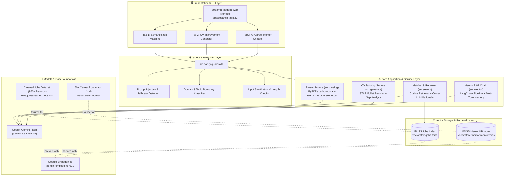
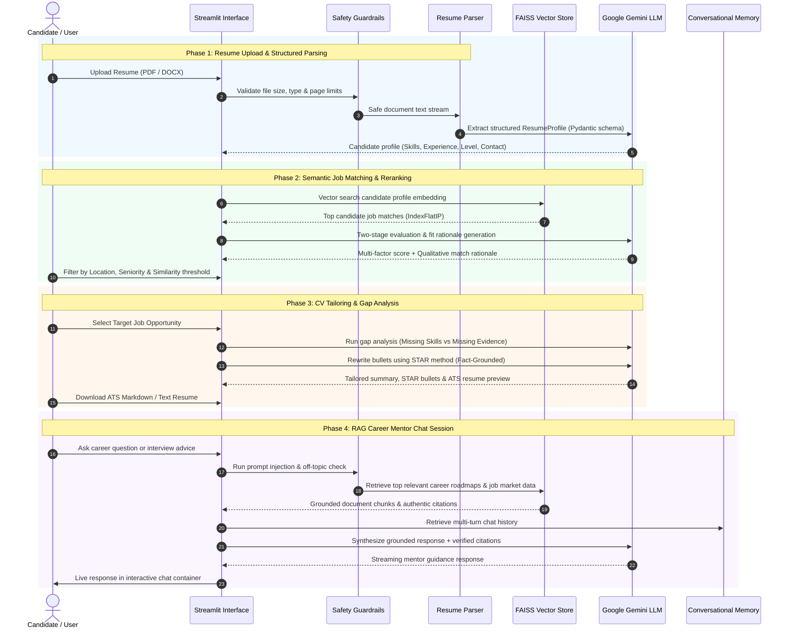

# SmartHire GenAI — Resume Matching & AI Career Mentor

An end-to-end Generative AI career portal that parses uploaded resumes, finds matching job opportunities via semantic vector search, provides AI-driven CV improvement recommendations, and offers a retrieval-augmented generation (RAG) AI Career Mentor chatbot.

> **🎓 Internship Capstone Project**  
> **Developer:** [Chitikeshi Neshnika]  
> **Role:** AI /GenAI Engineering Intern   

---

## 🌟 Key Features

### 📄 Resume Parser (Structured Output)
- **Deep Document Ingestion:** Robust extraction of candidate resumes in PDF and DOCX formats with built-in sanitization, page limits, and text length verification.
- **Structured Pydantic Extraction:** Employs Google Gemini structured output to extract standardized profile entities (`ResumeProfile`: candidate name, contact info, categorized technical skills, experience history, education, and seniority level).


### 🔍 Semantic Job Search (Embeddings & FAISS)
- **Dense Vector Embeddings:** Indexes job descriptions into high-dimensional vector representations using Google Gemini embeddings (`gemini-embedding-001`).
- **FAISS Similarity Retrieval:** Performs ultra-fast cosine similarity vector search (`IndexFlatIP`) based on candidate profiles to retrieve the most relevant job postings.
- **Two-Stage Reranking & Fit Rationale:** Evaluates top retrieved matches with Gemini LLM to generate transparent qualitative reasoning, fit percentages, and skill overlap insights.
- **Interactive Opportunity Filtering:** Real-time filtering by Seniority Level (Fresher, Junior, Mid, Senior), Location (Remote, Bengaluru, Delhi, etc.), and similarity score thresholds.

### ⚡ CV Improvement Generator
- **Actionable Gap Analysis:** Categorizes resume-to-job discrepancies into **Missing Skills** (technical gaps with targeted learning roadmaps) and **Missing Evidence** (existing candidate skills needing stronger bullet point prominence).
- **STAR-Method Bullet Point Engineering:** Rewrites experience bullet points following the **Situation-Task-Action-Result** framework to emphasize quantifiable impact, metrics, and technical execution.
- **Strict Fact Grounding:** Programmatic zero-hallucination guardrails ensure that all bullet improvements remain 100% faithful to candidate resume facts without inventing credentials or numbers.
- **Job-Tailored Executive Summary & ATS Export:** Produces a tailored professional summary and a complete ATS-optimized resume with live high-contrast paper preview and 1-click Markdown download.

### 🤖 AI Career Mentor Chatbot (RAG)
- **Enterprise RAG Knowledge Pipeline:** Retrieval-Augmented Generation built with LangChain and FAISS, grounded against 50+ curated technology career progression roadmaps and empirical job market records.
- **Multi-Turn Session Memory:** Maintains conversational context across multi-turn dialogues to handle follow-up inquiries naturally.
- **Verified Source Citations:** Guarantees transparent source attribution by referencing authentic career guides or job posting documents for every recommendation.
- **Dedicated Interactive UI Container:** Enclosed Streamlit chatbot container with real-time response simulation, contextual starter prompts, and one-click session clearing.

### 🛡️ Guardrails & Input Safety
- **Adversarial & Injection Defense:** Intercepts jailbreaks, prompt override attempts, and malicious payloads at the application layer before LLM invocation.
- **Domain Topic Enforcement:** Detects off-topic queries (e.g., sports, cooking trivia) and politely redirects candidates toward career and technical topics.
- **Hallucination Prevention:** Enforces strict evidence thresholds and returns safe, standardized fallbacks for out-of-corpus queries or unverified claims.

---

## 🏗️ System Architecture & Workflow

### 1. Multi-Tier System Architecture




---

### 2. End-to-End User Workflow Pipeline



---

## 📂 Repository Directory Layout

```text
smarthire-genai/
├── app/
│   └── streamlit_app.py          # Modern multi-tab Streamlit interface
├── data/
│   ├── career_notes/             # 50+ curated technology career roadmaps (.md)
│   └── jobs/                     # Cleaned job market dataset (CSV)
├── reports/
│   ├── answer_quality.md         # Automated RAG evaluation benchmark report
│   └── final_report.pdf          # Performance evaluation documentation
├── src/
│   ├── config.py                 # Central settings, paths, model constants
│   ├── evaluate.py               # 5-battery RAG evaluation engine
│   ├── generate/
│   │   ├── cv_suggestions.py     # Gap analysis, STAR rewriter, tailored resume builder
│   │   └── prompts.py            # Guarded LLM prompt engineering templates
│   ├── mentor/
│   │   ├── knowledge_base.py     # Knowledge base chunking & FAISS indexing
│   │   ├── memory.py             # Multi-turn conversation memory buffer
│   │   └── rag_chain.py          # Career mentor RAG chain with citation verification
│   ├── parsing/
│   │   ├── loader.py             # Multi-format document reader (PDF/DOCX)
│   │   └── resume_parser.py      # Structured entity & skill extractor
│   ├── safety/
│   │   └── guardrails.py         # Prompt injection detection & safety validation
│   └── search/
│       ├── candidate_analysis.py # Candidate profile synthesizer
│       ├── embed.py              # Gemini embedding generator with rate-limit pacing
│       ├── job_search.py         # FAISS vector similarity search
│       ├── matcher.py            # Two-stage semantic matcher pipeline
│       └── rerank.py             # LLM fit scoring & qualitative match rationales
├── tests/                        # 16 test suites covering retrieval, safety & generation
├── vectorstore/                  # Persisted FAISS indices (.faiss) & metadata
├── .env.example                  # Environment variable template
├── requirements.txt              # Project dependencies
└── README.md                     # Project documentation
```

---

## ⚡ Quickstart & Setup Guide

### 1. Prerequisites
- **Python**: Version `3.10` or higher (`3.11` recommended).
- **Google Gemini API Key**: Obtain a key from [Google AI Studio](https://aistudio.google.com/).

### 2. Setup Virtual Environment
Always use a dedicated virtual environment:

```powershell
# Windows
python -m venv .venv
.\.venv\Scripts\Activate.ps1
```

```bash
# macOS / Linux
python3 -m venv .venv
source .venv/bin/activate
```

### 3. Install Dependencies
```bash
python -m pip install --upgrade pip
python -m pip install -r requirements.txt
```

### 4. Configure Environment Variables
Create a `.env` file in the project root based on [.env.example](.env.example):

```env
GEMINI_API_KEY=your_actual_gemini_api_key_here
SIMILARITY_THRESHOLD=0.50
MIN_RETRIEVAL_RESULTS=5
```

### 5. Run the Application
Launch the Streamlit web dashboard:

```bash
streamlit run app/streamlit_app.py
```

Once started, open your browser at **`http://localhost:8501`**.

---

## 🧪 Testing & Evaluation Benchmark

SmartHire GenAI includes a comprehensive test suite and an automated audit harness covering semantic search, RAG accuracy, memory, and safety guardrails.

### Running Test Suites
```bash
python -m pytest tests/ -v
```

### Automated RAG Benchmark (`src/evaluate.py`)
Run the 5-battery evaluation harness testing grounding, citation accuracy, out-of-corpus handling, and adversarial resilience:

```bash
python src/evaluate.py
```

#### Benchmark Audit Results ([reports/answer_quality.md](reports/answer_quality.md))
```text
Evaluation Battery               Cases Tested    Passed    Pass Rate
────────────────────────────────────────────────────────────────────
Supported Career Note Queries          3            3       100.0%
Supported Job Market Queries           1            1       100.0%
Unsupported Out-of-Corpus Queries      1            1       100.0%
Unsupported Unverified Fact Queries    1            1       100.0%
Unsafe Prompt Injection Payloads       1            1       100.0%
Unsafe Malware / Exploit Payloads      1            1       100.0%
Off-Topic Trivia & Distractions        1            1       100.0%
Off-Topic Sports Inquiries             1            1       100.0%
Multi-Turn Session Memory              1            1       100.0%
────────────────────────────────────────────────────────────────────
Overall Benchmark Score: 100.0% (11 / 11 Passed)
```

---

## 🛠️ Technology Stack

- **Core & UI**: [Streamlit](https://streamlit.io/), Python 3.10+
- **Large Language Models**: [Google Gemini Flash](https://ai.google.dev/) (`gemini-3.5-flash-lite`) via `google-genai`
- **Embeddings & Vector Search**: `gemini-embedding-001`, [FAISS (Facebook AI Similarity Search)](https://github.com/facebookresearch/faiss)
- **Document Parsing**: [PyPDF](https://pypi.org/project/pypdf/), [python-docx](https://python-docx.readthedocs.io/), [LangChain Text Splitters](https://python.langchain.com/)
- **Data Engineering**: [Pandas](https://pandas.pydata.org/), NumPy
- **Quality Assurance**: [Pytest](https://docs.pytest.org/), Pydantic


### Acknowledgments
I would like to express my sincere gratitude to my internship mentor, team leads, and reviewers for their continuous support, architectural guidance, and feedback throughout the development and benchmarking of this system.

---

## 📄 License

Distributed under the **MIT License**. Free for educational, academic, and evaluation purposes.
